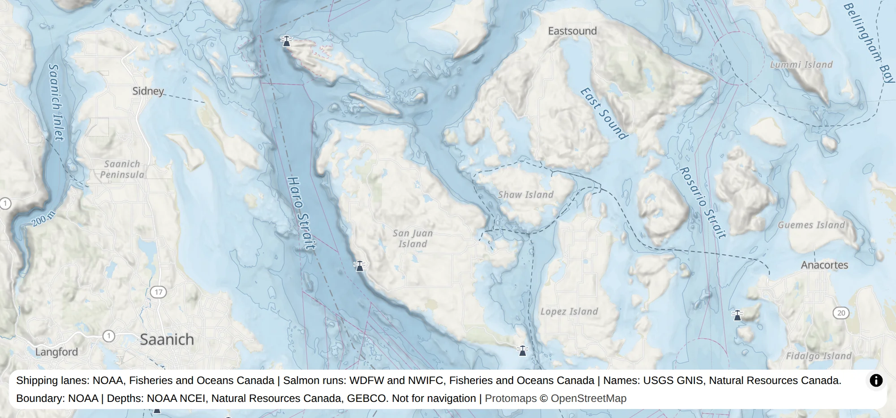
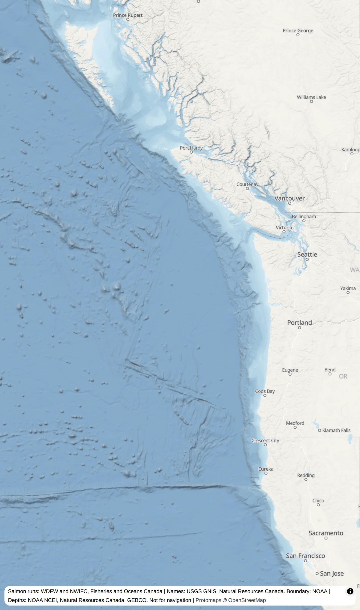
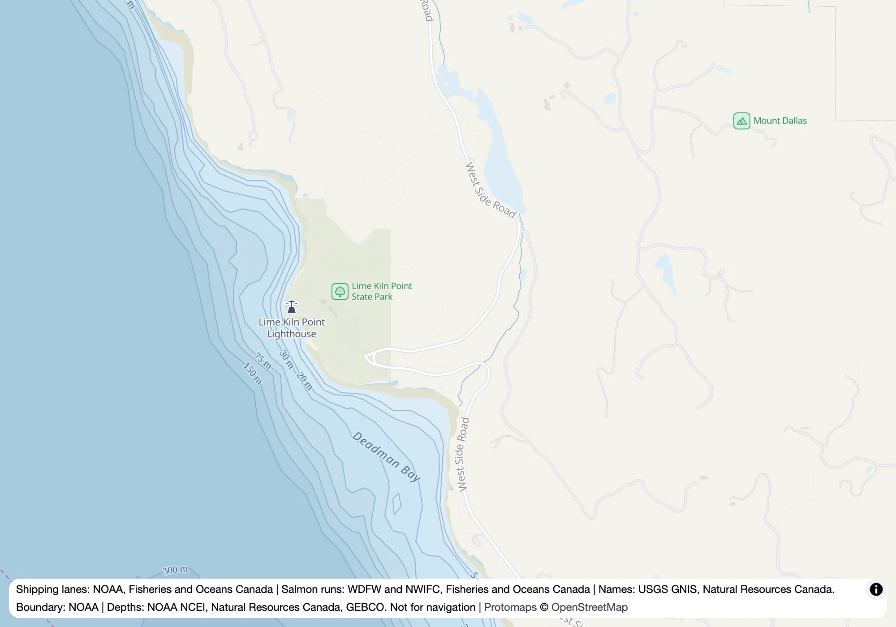
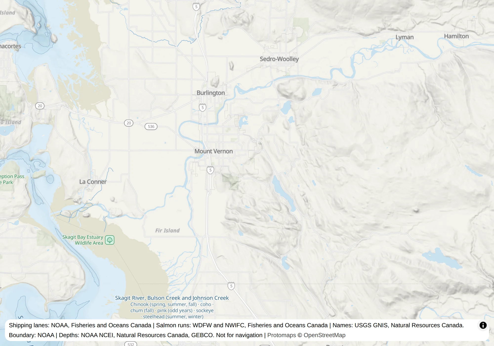
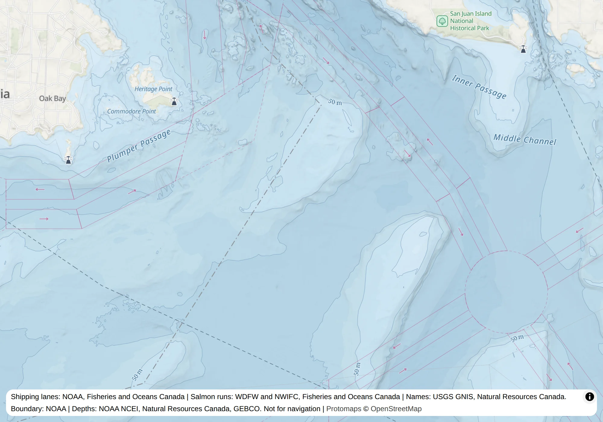

# Salish Sea basemap



A basemap of the Northeast Pacific coast, from Monterey Bay to Haida Gwaii, built from open data for [SalishSea.io](https://salishsea.io) and [Orcasound](https://live.orcasound.net). It covers the whole range of the Southern Resident killer whales, who spend much of the year in the Salish Sea and travel the outer coast from California to southeast Alaska, so it reaches far beyond the Salish Sea itself. It keeps showing depth and shoreline at the zooms where Esri's ocean tiles go blank, and it is drawn quietly, so that the data a site draws on it, such as whale sightings, stays the most visible thing on the map.



It is published at `tiles.salishsea.io` as a [MapLibre](https://maplibre.org) style and the vector tiles it draws from. Beside them are image tiles, for stitching into a picture, and lists of place names, for a search.

## The newest version

<!-- newest-version: written by scripts/readme-version.ts -->
The newest version is **2026.11.3**.

- Its index page shows the map and every name it labels, and links every file it is made of: https://tiles.salishsea.io/2026.11.3/index.html
- Its style, for a MapLibre map: https://tiles.salishsea.io/2026.11.3/style.json
<!-- /newest-version -->

**Start from a version's index page.** It shows the version's map and a table of every name the map labels, with the zoom each first appears at: choose a name to see it on the map. It also links every file the version is made of. The same table is in `names.tsv` beside the page, for a spreadsheet. What changed in each version is in [CHANGELOG.md](CHANGELOG.md).

You can't build the URLs of the image tiles or the place lists from a version number. They are named for what they hold, so that versions which don't change them share one set of files. Find them on the index page, or in the metadata of the version's style:

```sh
curl -s https://tiles.salishsea.io/2026.11.3/style.json | jq .metadata
```

## Using it

Point a MapLibre map at a version's style. The style reads its tiles from [PMTiles](https://docs.protomaps.com/pmtiles/) archives, so register the `pmtiles` protocol first:

```js
import maplibregl from 'maplibre-gl';
import { Protocol } from 'pmtiles';

maplibregl.addProtocol('pmtiles', new Protocol().tile);
const map = new maplibregl.Map({
  container: 'map',
  style: 'https://tiles.salishsea.io/2026.11.3/style.json',
  center: [-123.1, 48.5], zoom: 9,
  minZoom: 3, maxBounds: [[-180, 15], [-90, 70]],
});
```

- **Pin a version.** A published version never changes, so a page that names one always draws the same map, and every file can be cached for a year. Versions are numbered by date, in CalVer: `2026.10.1`, then `2026.10.2`, then `2026.11.1`. They are this repository's [tags](https://github.com/salish-sea/basemap/tags), each on the commit that built it ([decision 007](decisions/007-published-builds-are-dated-and-never-change.md)).
- **Any site may use it.** Every response allows any origin. Everything the style needs, its fonts and icons included, comes from tiles.salishsea.io, so a page's content security policy needs to allow only that one site ([010](decisions/010-fonts-and-icons-are-served-with-the-tiles.md)).
- **Keep to the coverage, so the map is never blank.** The `minZoom` and `maxBounds` above do this. The detailed map covers 136–120°W and 36–54.8°N from zoom 5; around it, and below zoom 5, a coarse map from GEBCO covers 180–90°W and 15–70°N ([decision 012](decisions/012-a-coarse-map-covers-the-northeast-pacific.md)).
- **It is in Web Mercator,** like most web maps. MapLibre's globe projection works too, but at zoom 3 it shows the edge of the coarse map, which `maxBounds` can't hide on a globe ([decision 013](decisions/013-the-tiles-are-in-web-mercator.md)).
- **Draw your data on top.** Layers you add after the style loads go above everything in it, labels included, which is where sightings belong.
- **Turn the relief off on a slow device:** `map.setLayoutProperty('relief', 'visibility', 'none')`. The relief is the light and shadow of the seafloor and land, which the browser shades.
- **Keep the attribution.** The style credits its sources, and MapLibre's attribution control shows them, including that the map is not for navigation.

## Image tiles

For things that stitch tiles into a picture rather than draw a map, such as SalishSea.io's preview cards. They are drawn from the same style, without its labels, as WebP. A version's style names them in its metadata, as `salishsea:images`: a URL with `{z}`, `{x}` and `{y}` in it ([decision 014](decisions/014-image-tiles-are-drawn-from-the-style-along-the-shore.md)).

- **They are numbered as Esri's are,** in 256-pixel tiles, each drawn at 512 pixels for high-density screens. So image zoom 10 shows what a MapLibre map shows at zoom 9; every other zoom in this README is MapLibre's.
- **They cover zooms 0 to 5** over the coarse map's area, **6 to 10** over the coast and a little past it, and **11 to 14** only along the Salish Sea's shore. For a picture framed closer than 14, enlarge zoom 14's tiles. Up to 2026.11.3 they went to 15.
- **Which tiles exist is listed** in `tiles.txt` beside them, one `z x y` to a line. Ask only for those: the server answers a missing tile with 403, the same as it would if something were broken.

## Place lists

For a search that takes people to a place on the map. A version's style names them in its metadata, under `salishsea:places`, and its index page links them ([decision 018](decisions/018-the-names-the-map-labels-are-published-as-lists.md)):

| List | What it holds | For search? |
|---|---|---|
| `gazetteers` | The larger bodies of water and points, from the US and Canadian government gazetteers | Yes |
| `osm` | The larger islands, cities, towns, villages and ferry terminals, from OpenStreetMap, under the ODbL | Yes |
| `parks` | The parks on the shore, from OpenStreetMap, under the ODbL, for telling where the person who reported a sighting stood | No: a search shouldn't load it |
| `regions` | The water regions: one outline for each water name the map labels, together covering the water ([027](decisions/027-every-water-name-has-a-region-and-the-regions-cover-the-water.md)) | No |

The two lists for search hold about 2,100 places. Each of the first three states its sources and licence, names its fields in `columns`, and gives each place as a row: the name, its kind, a longitude and latitude to look at, a zoom to look from, and any other names it goes by. Where two of the gazetteers' places share a name, the `osm` list's `gazetteer_islands` says which island each is on; it comes from OpenStreetMap's outlines of the islands, so it is kept with OpenStreetMap's data.

The `regions` list is GeoJSON instead. Each region has a `name` to show a person, such as "Mud Bay (Sucia Island)" where several share a name, and a `base` name, as the map labels it. The regions are in the tiles as well, hidden: set the layers `water_regions_fill` and `water_regions_line` to visible to see them.

## The water mask

For measuring distance by sea rather than in a straight line. It is a 1-bit PNG of the water at about 90 m, white where there is water, its rows from north to south, with a JSON file that gives the area it covers and the size of a cell. A version's style names both under `salishsea:water`, as `mask` and `grid`. A search for a route across it must allow diagonal steps between cells; with only straight steps, narrow passages such as Dodd Narrows are closed ([decision 028](decisions/028-the-water-mask-is-published.md)).

<br clear="right">

## What it shows

- **Depth** is tinted in bands, darker where deeper, with labelled isobaths; the deepest band, from 2000 m, runs to the seafloor's lowest point.
- **Ground that dries at low tide**, such as the mud flats of Boundary Bay, is khaki ([004](decisions/004-ground-that-dries-at-low-tide-is-drawn.md)).
- **Relief** shades the seafloor and the land lightly, the mountains more lightly still, so they don't draw the eye from the water, and fades out by zoom 13, before it would blur ([002](decisions/002-the-relief-is-shaded-by-maplibre.md)).
- **Land** is one flat colour, so that sightings stand out, except parks, state parks among them, in a faint green: many are where people watch from shore. Rivers and streams are blue ([003](decisions/003-land-is-flat-except-parks.md)). A large park is named at its headquarters or visitor centre, if it has one ([026](decisions/026-parks-are-named-at-their-headquarters-and-reserves-tinted-on-the-land.md)).
- **Ferry routes** are dashed, from zoom 9, because many casual sightings are made from ferries ([005](decisions/005-ferry-routes-are-drawn-from-zoom-9.md)).
- **Landmarks** people steer by: lighthouses, tall radio and television towers, and what the charts mark as conspicuous from the water, each with an icon and, closer in, its name ([015](decisions/015-landmarks-are-what-the-charts-mark-and-tall-towers.md)).
- **Places people watch from**, such as beaches, parks, nature reserves, marinas and ferry terminals, are named from OpenStreetMap; shops, restaurants and other businesses are not ([016](decisions/016-points-of-interest-are-where-people-watch-from.md)).
- **Peninsulas** are named from a zoom set by their size, Key Peninsula from 7 and Miller Peninsula from 8 ([023](decisions/023-peninsulas-are-named-from-a-zoom-set-by-their-size.md)).
- **Salmon runs** at the mouth of each named river that reaches the sea, such as "Chinook (spring, summer, fall) · coho · chum (fall)", because resident killer whales follow salmon ([020](decisions/020-each-river-mouth-is-labelled-with-its-salmon-runs.md)).
- **Shipping lanes** and two-way routes, faintly outlined from zoom 8, with precautionary areas dashed, arrows for their direction from 10 and names such as "Northbound lane" from 12, as reports name them. They are left out of the image tiles ([019](decisions/019-shipping-lanes-are-drawn-from-the-charts.md)).
- **Bays, straits, channels and points** are named from the US and Canadian government gazetteers, and the boundary at sea is drawn ([006](decisions/006-marine-names-and-the-boundary-come-from-government-gazetteers.md)).
- **Water regions** are in the tiles but hidden; see [Place lists](#place-lists).



*Lime Kiln Point at zoom 14, where Esri's ocean tiles show "Map data not yet available". The relief has faded out, and the isobaths and depth bands carry the seafloor.*



*The Skagit at zoom 10, where a salmon river reads as plainly as the interstate beside it.*



*Off Victoria at zoom 10.6: the Strait of Juan de Fuca's lanes meet Haro Strait's, outlined faintly so they don't crowd what a site draws on top.*


*The Skagit's runs at zoom 10.6, labelled where its South Fork reaches the flats of Skagit Bay.*

## What it is built from

| Layer | Source | Terms |
|---|---|---|
| Land, roads, places, water outlines | [Protomaps](https://protomaps.com) daily build of OpenStreetMap | ODbL |
| Ferry routes | The same Protomaps extract, redrawn so that each channel has one line at low zooms ([005](decisions/005-ferry-routes-are-drawn-from-zoom-9.md)) | ODbL |
| Depth labels' typeface | [Noto Serif](https://github.com/notofonts/latin-greek-cyrillic), from the Noto project ([017](decisions/017-depth-labels-are-set-in-a-serif.md)); the other labels' fonts and the icons are Protomaps' ([010](decisions/010-fonts-and-icons-are-served-with-the-tiles.md)) | SIL Open Font Licence |
| Landmarks | OpenStreetMap, from [Geofabrik](https://download.geofabrik.de)'s extracts ([015](decisions/015-landmarks-are-what-the-charts-mark-and-tall-towers.md)); icons from [Maki](https://github.com/mapbox/maki) | ODbL; icons public domain (CC0) |
| Names of bays, straits, channels and points on the US side | USGS [Geographic Names Information System](https://www.usgs.gov/tools/geographic-names-information-system-gnis), placed and timed against the depth grid ([006](decisions/006-marine-names-and-the-boundary-come-from-government-gazetteers.md)) | Public domain |
| The same on the Canadian side | Natural Resources Canada's [Canadian Geographical Names Database](https://open.canada.ca/data/en/dataset/e27c6eba-3c5d-4051-9db2-082dc6411c2c) | Open Government Licence – Canada |
| Salmon and steelhead runs on each river | WDFW and the Northwest Indian Fisheries Commission's [SWIFD](https://geodataservices.wdfw.wa.gov/arcgis/rest/services/MapServices/SWIFD/MapServer/0) in Washington; Fisheries and Oceans Canada's [NuSEDS](https://open.canada.ca/data/en/dataset/c48669a3-045b-400d-b730-48aafe8c5ee6) in British Columbia ([020](decisions/020-each-river-mouth-is-labelled-with-its-salmon-runs.md)) | "Open for public consumption"; Open Government Licence – Canada |
| Shipping lanes | NOAA's [ENC Direct](https://encdirect.noaa.gov/) wherever NOAA charts, including Haro Strait and Boundary Pass; Fisheries and Oceans Canada's [Vessel Traffic Routes](https://open.canada.ca/data/en/dataset/6ab2803a-aace-4e60-83ed-44a7e0ccd1d8) where it doesn't ([019](decisions/019-shipping-lanes-are-drawn-from-the-charts.md)) | Public domain; Open Government Licence – Canada |
| Water regions, one per water name the map labels, covering the water from 42°N to 51.5°N ([027](decisions/027-every-water-name-has-a-region-and-the-regions-cover-the-water.md)) | The names above; Natural Resources Canada's outlines and NOAA's [ENC Direct](https://encdirect.noaa.gov/) named sea areas and land; British Columbia's [terrestrial boundary](https://catalogue.data.gov.bc.ca/dataset/province-of-british-columbia-boundary-terrestrial); the depth grids and drying ground below | Public domain; Open Government Licence – Canada; Open Government Licence – British Columbia |
| The Canada–US boundary at sea | NOAA's [maritime limits and boundaries](https://nauticalcharts.noaa.gov/data/us-maritime-limits-and-boundaries.html) | Public domain |
| Depths and relief wherever Canada's grid has data: north of about 48.06°N, which takes in the Strait of Juan de Fuca, Haro Strait, the San Juan Islands and the north end of Admiralty Inlet | Natural Resources Canada's [West Coast topo-bathymetric DEM](https://open.canada.ca/data/dataset/e6e11b99-f0cc-44f7-f5eb-3b995fb1637e), resampled from 10 m to 30 m | Open Government Licence – Canada |
| Depths and relief everywhere else near the coast, including Puget Sound, Hood Canal and the Washington coast | NOAA's [Coastal Relief Model](https://www.ncei.noaa.gov/products/coastal-relief-model), 1 arc-second (about 30 m) | Public domain |
| Depths in the deep ocean, beyond those grids; and, averaged to about 2.5 km, the coarse map of the whole Northeast Pacific shown zoomed out and past the coast's edges | [GEBCO](https://www.gebco.net/data-products/gridded-bathymetry-data)'s global grid, 15 arc-seconds (about 450 m) ([009](decisions/009-gebco-fills-the-deep-ocean.md), [012](decisions/012-a-coarse-map-covers-the-northeast-pacific.md)) | Public domain |

Canada's grid is preferred because NOAA's shows straight seams where its survey patches meet. The two measure height from different levels, so Canada's depths read 1–2 m shallower; each is kept as published, except within 4 km of a grid's edge, where it is blended with the grid beneath ([001](decisions/001-canadas-depth-grid-comes-first.md), [009](decisions/009-gebco-fills-the-deep-ocean.md)).

Anything derived from OpenStreetMap is kept in archives and lists of its own, so that the ODbL's share-alike terms don't reach the public-domain and Canadian data. The map is not for navigation.

Why one 30 m grid, and why not the Canadian Hydrographic Service's own depths, is in SalishSea.io's decision [073](https://github.com/salish-sea/salishsea-io/blob/main/docs/decisions/073-the-basemap-depths-are-30-m-lightly-shaded.md). Why the basemap is its own project is in [074](https://github.com/salish-sea/salishsea-io/blob/main/docs/decisions/074-the-basemap-is-its-own-project-and-the-cards-draw-on-it.md). Decisions made since are in [decisions/](decisions/).

## Contributing

How to build the map, draw this README's pictures and publish a version is in [CONTRIBUTING.md](CONTRIBUTING.md). The pictures are drawn from the build by `make pictures`, so they show the map as it is.

## Licence

Code is MIT; documentation and the style are CC BY 4.0. Built tiles and lists carry their sources' terms (above): those from OpenStreetMap are under the ODbL. See [LICENSE](LICENSE).
