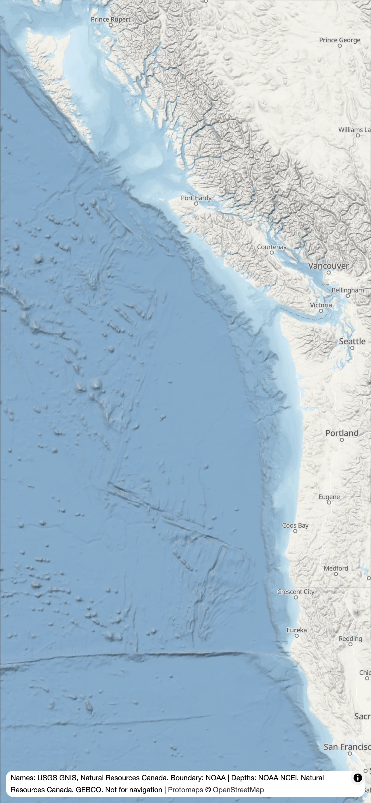
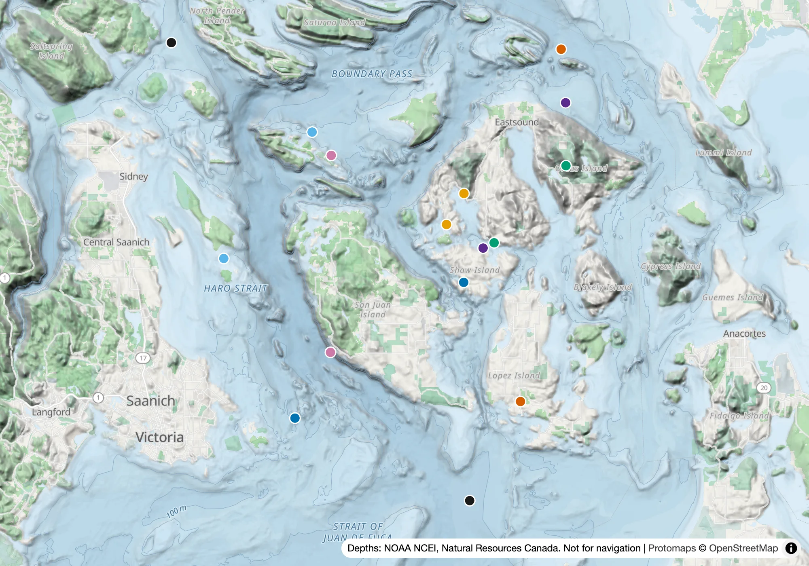
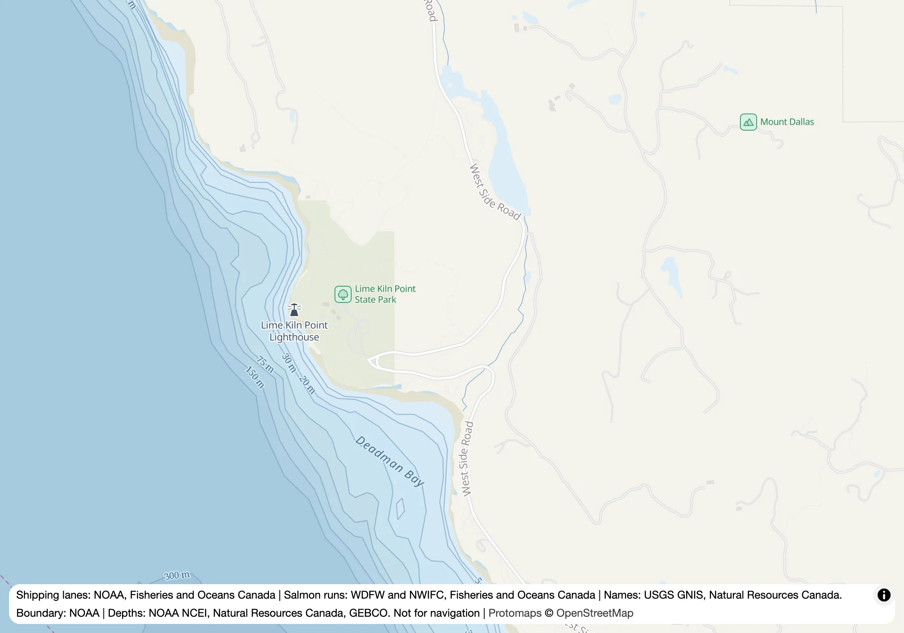
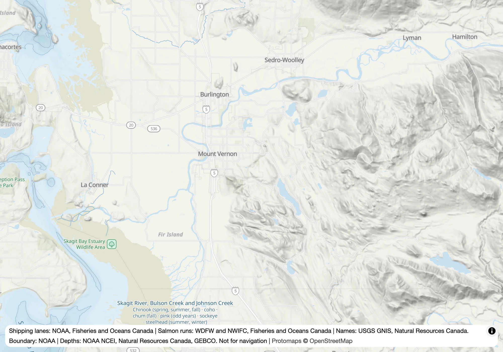

# Salish Sea basemap

A basemap of the Northeast Pacific coast, from Monterey Bay to Haida Gwaii, built from open data for [SalishSea.io](https://salishsea.io) and [Orcasound](https://live.orcasound.net). It keeps showing depth and shoreline at the zooms where Esri's ocean tiles go blank, and it is drawn so that the coloured dots of whale sightings stay the most visible thing on the map.



It is published at `tiles.salishsea.io` as a [MapLibre](https://maplibre.org) style and the vector tiles it draws from, with image tiles and lists of place names beside them.

<!-- newest-version: written by scripts/readme-version.ts -->
The newest version is **2026.10.15**:

- A page linking every file of the version: https://tiles.salishsea.io/2026.10.15/index.html
- Style: https://tiles.salishsea.io/2026.10.15/style.json
- A page for trying it out beside Esri's map: https://tiles.salishsea.io/2026.10.15/viewer/index.html
- Image tiles, for stitching into a picture: `https://tiles.salishsea.io/images/86f8ccd15381ab0e/{z}/{x}/{y}.webp`
- Place names of water bodies and points, from the US and Canadian gazetteers: https://tiles.salishsea.io/places/places-gazetteers-6ebc4b7473854290.json
- Place names of islands, cities, towns, villages and ferry terminals, from OpenStreetMap, under the ODbL: https://tiles.salishsea.io/places/places-osm-c2e7cd37c8651122.json
<!-- /newest-version -->

The image tiles and place lists are named for their contents, not for a version, so that a version that doesn't change them shares the earlier version's files. Their URLs can't be guessed from a version number. Each version's [release](https://github.com/salish-sea/basemap/releases) links a page that lists them, for versions after 2026.10.13, and each version's style names them in its metadata. To read them from any version:

```sh
curl -s https://tiles.salishsea.io/2026.10.15/style.json | jq .metadata
```

The pictures in this README are drawn from the build by `make pictures` ([CONTRIBUTING](CONTRIBUTING.md#pictures)), so they show the map as it is.

## Using it

Point a MapLibre map at a version's style. The style reads its tiles from [PMTiles](https://docs.protomaps.com/pmtiles/) archives, so register the `pmtiles` protocol first:

```js
import maplibregl from 'maplibre-gl';
import { Protocol } from 'pmtiles';

maplibregl.addProtocol('pmtiles', new Protocol().tile);
const map = new maplibregl.Map({
  container: 'map',
  style: 'https://tiles.salishsea.io/2026.10.15/style.json',
  center: [-123.1, 48.5], zoom: 9,
  minZoom: 3, maxBounds: [[-180, 15], [-90, 70]],
});
```

- **Pin a version.** A published version never changes, so a page that names one always draws the same map, and every file can be cached for a year. A new version gets a new number, in CalVer: `2026.10.1`, then `2026.10.2`, then `2026.11.1`. The versions are this repository's [tags](https://github.com/salish-sea/basemap/tags), each on the commit that built it ([decision 007](decisions/007-published-builds-are-dated-and-never-change.md)).
- **Any site may use it.** Every response allows any origin.
- **Keep to the coverage.** The coast's detailed layers cover 136–120°W, 36–54.8°N, from zoom 5. Around them, and below zoom 5, a coarse map from GEBCO covers 180–90°W, 15–70°N, so the `minZoom` and `maxBounds` above keep a map where there is always something drawn ([decision 012](decisions/012-a-coarse-map-covers-the-northeast-pacific.md)).
- **It is in Web Mercator,** like the tiles of most web maps. MapLibre's globe projection draws it on a sphere instead, which shows Alaska at its true size beside California when zoomed out; but at zoom 3 the globe shows the edge of the coarse map's coverage, which `maxBounds` doesn't hide there ([decision 013](decisions/013-the-tiles-are-in-web-mercator.md)).
- **Draw your data on top.** Layers you add after the style loads go above everything in it, labels included, which is where sightings belong.
- **Turn the relief off on a slow device:** `map.setLayoutProperty('relief', 'visibility', 'none')`. The relief is the light and shadow of the seafloor and land, shaded by the browser.
- **Keep the attribution.** The style credits its sources, which MapLibre's attribution control shows, including that the map is not for navigation; the depth grids are credited once, for both the depths and the relief. Archives derived from OpenStreetMap are under the ODbL.

Everything the style needs, the labels' fonts and the icons included, is served from tiles.salishsea.io, so a page that uses it needs to allow only that one site ([010](decisions/010-fonts-and-icons-are-served-with-the-tiles.md)). **Image tiles,** for things that stitch tiles into a picture rather than draw a map, such as SalishSea.io's preview cards, are drawn from the same style without its labels. A version's style names them in its metadata, as `salishsea:images`: a URL with `{z}`, `{x}` and `{y}` in it, in 256-pixel tiles, as Esri's are, each drawn at 512 pixels for high-density screens. They cover zooms 0 to 5 over the coarse map's area, zooms 6 to 10 over the coast and a little past it, and zooms 11 to 15 only along the Salish Sea's shore ([decision 014](decisions/014-image-tiles-are-drawn-from-the-style-along-the-shore.md)).

**Place names,** for a search that takes people to a place on the map, are named in the metadata under `salishsea:places`, and the newest version's are linked above: the URLs of two JSON lists, `gazetteers` and `osm`, of the Salish Sea's places that a search offers, about 2,100 in all. One holds the larger water bodies and points from the two gazetteers. The other holds the larger islands, cities, towns, villages and ferry terminals from OpenStreetMap, under the ODbL. Each list states its sources and licence, then gives each place as a row of its `columns`: the name, its kind, a longitude and latitude to look at, a zoom to look from (MapLibre's, which counts 512-pixel tiles), and any other names it goes by. The OpenStreetMap list also says, under `gazetteer_islands`, which island each of the gazetteers' places that shares its name with another is on, to tell them apart; it is found from OpenStreetMap's outlines, so it is kept there ([decision 018](decisions/018-the-names-the-map-labels-are-published-as-lists.md)).

<br clear="right">

## What it shows



*The San Juan Islands at zoom 9.4. The coloured dots stand in for whale sightings, in SalishSea.io's colours.*

- **Depth** is tinted in bands, darker where deeper, with labelled isobaths; the deepest band, from 2000 m, runs to the seafloor's lowest point.
- **Ground that dries at low tide**, such as the mud flats of Boundary Bay, is khaki ([004](decisions/004-ground-that-dries-at-low-tide-is-drawn.md)).
- **Relief** shades the seafloor and the land lightly, and fades out by zoom 13, before it would blur ([002](decisions/002-the-relief-is-shaded-by-maplibre.md)).
- **Land** is one flat colour, so that sightings stand out, except parks in a faint green: many are where people watch from shore. Rivers and streams are blue ([003](decisions/003-land-is-flat-except-parks.md)).
- **Ferry routes** are dashed, from zoom 9, because many casual sightings are made from ferries ([005](decisions/005-ferry-routes-are-drawn-from-zoom-9.md)).
- **Landmarks** people steer by: lighthouses, tall radio and television towers, and what the charts mark as conspicuous from the water, each with an icon and, closer in, its name ([015](decisions/015-landmarks-are-what-the-charts-mark-and-tall-towers.md)).
- **Places people watch from**, such as beaches, parks, marinas and ferry terminals, are named from OpenStreetMap; shops, restaurants and other businesses are not ([016](decisions/016-points-of-interest-are-where-people-watch-from.md)).
- **Salmon runs** at the mouth of each named river that reaches the sea, such as "Chinook (spring, summer, fall) · coho · chum (fall)", because resident killer whales follow salmon ([020](decisions/020-each-river-mouth-is-labelled-with-its-salmon-runs.md)).
- **Shipping lanes**, the separation zones between them, two-way routes and precautionary areas, from zoom 8, with arrows for their direction and, closer in, names such as "Northbound lane", as reports name them. They are left out of the image tiles ([019](decisions/019-shipping-lanes-are-drawn-from-the-charts.md)).
- **Bays, straits, channels and points** are named from the US and Canadian government gazetteers, and the boundary at sea is drawn ([006](decisions/006-marine-names-and-the-boundary-come-from-government-gazetteers.md)).



*Lime Kiln Point at zoom 14, where Esri's ocean tiles show "Map data not yet available". The relief has faded out, and the isobaths and depth bands carry the seafloor.*



*The Skagit at zoom 10, where a salmon river reads as plainly as the interstate beside it.*


*Off Victoria at zoom 10.6: the Strait of Juan de Fuca's lanes meet Haro Strait's, under the sightings.*


*The Skagit's runs at zoom 10.6, labelled where its South Fork reaches the flats of Skagit Bay.*

## What it is built from

| Layer | Source | Terms |
|---|---|---|
| Land, roads, places, water outlines | [Protomaps](https://protomaps.com) daily build of OpenStreetMap | ODbL |
| Ferry routes | The same Protomaps extract, redrawn so that each channel has one line at low zooms ([005](decisions/005-ferry-routes-are-drawn-from-zoom-9.md)) | ODbL |
| Depth labels' typeface | [Noto Serif](https://github.com/notofonts/latin-greek-cyrillic), from the Noto project ([017](decisions/017-depth-labels-are-set-in-a-serif.md)); the other labels' fonts and the icons are Protomaps' ([010](decisions/010-fonts-and-icons-are-served-with-the-tiles.md)) | SIL Open Font Licence |
| Landmarks | OpenStreetMap, from [Geofabrik](https://download.geofabrik.de)'s extracts ([015](decisions/015-landmarks-are-what-the-charts-mark-and-tall-towers.md)); icons from [Maki](https://github.com/mapbox/maki) | ODbL; icons public domain (CC0) |
| Names of bays, straits, channels and points on the US side | USGS [Geographic Names Information System](https://www.usgs.gov/tools/geographic-names-information-system-gnis), placed and timed against the depth grid ([006](decisions/006-marine-names-and-the-boundary-come-from-government-gazetteers.md)) | Public domain |
| The same on the Canadian side | Natural Resources Canada's [Canadian Geographical Names Database](https://open.canada.ca/data/en/dataset/e27c6eba-3c5d-4051-9db2-082dc6411c2c) | Open Government Licence – Canada |
| Salmon and steelhead runs on each river | WDFW and the Northwest Indian Fisheries Commission's [SWIFD](https://geodataservices.wdfw.wa.gov/arcgis/rest/services/MapServices/SWIFD/MapServer/0) in Washington; Fisheries and Oceans Canada's [NuSEDS](https://open.canada.ca/data/en/dataset/c48669a3-045b-400d-b730-48aafe8c5ee6) in British Columbia ([020](decisions/020-each-river-mouth-is-labelled-with-its-salmon-runs.md)) | "Open for public consumption"; Open Government Licence – Canada |
| Shipping lanes | NOAA's [ENC Direct](https://encdirect.noaa.gov/) wherever NOAA charts, including Haro Strait and Boundary Pass; Fisheries and Oceans Canada's [Vessel Traffic Routes](https://open.canada.ca/data/en/dataset/6ab2803a-aace-4e60-83ed-44a7e0ccd1d8) where it doesn't ([019](decisions/019-shipping-lanes-are-drawn-from-the-charts.md)) | Public domain; Open Government Licence – Canada |
| The Canada–US boundary at sea | NOAA's [maritime limits and boundaries](https://nauticalcharts.noaa.gov/data/us-maritime-limits-and-boundaries.html) | Public domain |
| Depths and relief wherever Canada's grid has data: north of about 48.06°N, which takes in the Strait of Juan de Fuca, Haro Strait, the San Juan Islands and the north end of Admiralty Inlet | Natural Resources Canada's [West Coast topo-bathymetric DEM](https://open.canada.ca/data/dataset/e6e11b99-f0cc-44f7-f5eb-3b995fb1637e), resampled from 10 m to 30 m | Open Government Licence – Canada |
| Depths and relief everywhere else near the coast, including Puget Sound, Hood Canal and the Washington coast | NOAA's [Coastal Relief Model](https://www.ncei.noaa.gov/products/coastal-relief-model), 1 arc-second (about 30 m) | Public domain |
| Depths in the deep ocean, beyond those grids; and, averaged to about 2.5 km, the coarse map of the whole Northeast Pacific shown zoomed out and past the coast's edges | [GEBCO](https://www.gebco.net/data-products/gridded-bathymetry-data)'s global grid, 15 arc-seconds (about 450 m) ([009](decisions/009-gebco-fills-the-deep-ocean.md), [012](decisions/012-a-coarse-map-covers-the-northeast-pacific.md)) | Public domain |

Canada's grid is preferred because NOAA's shows straight seams where its survey patches meet. The two measure height from different levels, so Canada's depths read 1–2 m shallower; each is kept as published, except within 4 km of a grid's edge, where it is blended with the grid beneath ([001](decisions/001-canadas-depth-grid-comes-first.md), [009](decisions/009-gebco-fills-the-deep-ocean.md)).

Anything derived from OpenStreetMap is kept in archives and lists of its own, so that the ODbL's share-alike terms don't reach the public-domain and Canadian data. The map is not for navigation.

Why one 30 m grid, and why not the Canadian Hydrographic Service's own depths, is in SalishSea.io's decision [073](https://github.com/salish-sea/salishsea-io/blob/main/docs/decisions/073-the-basemap-depths-are-30-m-lightly-shaded.md). Why the basemap is its own project is in [074](https://github.com/salish-sea/salishsea-io/blob/main/docs/decisions/074-the-basemap-is-its-own-project-and-the-cards-draw-on-it.md). Decisions made since are in [decisions/](decisions/).

## Contributing

How to build the map, draw this README's pictures and publish a version is in [CONTRIBUTING.md](CONTRIBUTING.md).

## Licence

Code is MIT; documentation and the style are CC BY 4.0. Built tiles carry their sources' terms (above). See [LICENSE](LICENSE).
