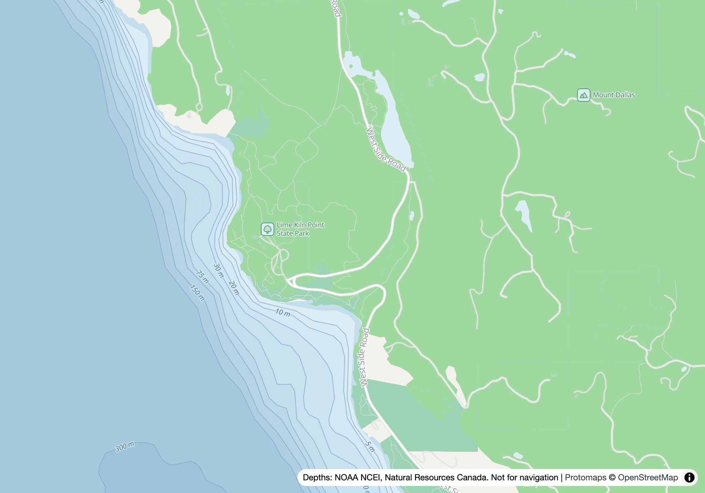

# Salish Sea basemap

A basemap of the Northeast Pacific coast, from Monterey Bay to Haida Gwaii, built from open data for [SalishSea.io](https://salishsea.io) and [Orcasound](https://live.orcasound.net). It keeps showing depth and shoreline at the zooms where Esri's ocean tiles go blank, and it is drawn so that the coloured dots of whale sightings stay the most visible thing on the map.

**Status: first build, over a test window around Haro Strait (124.0–122.2°W, 48.0–49.2°N).** Nothing serves it yet.


*The test window at MapLibre zoom 9.4. The coloured dots are stand-ins for whale sightings, in SalishSea.io's colours.*



*Lime Kiln Point at MapLibre zoom 14, where Esri's ocean tiles show "Map data not yet available". The relief has faded out by this zoom, and the isobaths and depth bands carry the seafloor.*

## What it publishes

From one style, two forms of the same map:

- **Vector tiles and a MapLibre style**, for interactive maps. Vectors stay sharp at any zoom and can be restyled without a rebuild.
- **Image tiles rendered from that style** (256-pixel), for anything that stitches images together rather than drawing a map, such as SalishSea.io's preview cards and the small maps on its profile pages.

They will be served from `tiles.salishsea.io`, each build under its own versioned path, so that a rebuild never changes what a published page shows.

## What it is built from

| Layer | Source | Terms |
|---|---|---|
| Land, roads, places, water outlines | [Protomaps](https://protomaps.com) daily build of OpenStreetMap | ODbL |
| Ferry routes | The same Protomaps extract, redrawn so that each channel has one line at low zooms ([005](decisions/005-ferry-routes-are-drawn-from-zoom-9.md)) | ODbL |
| Names of bays, straits, channels and points on the US side | USGS [Geographic Names Information System](https://www.usgs.gov/tools/geographic-names-information-system-gnis), placed and timed against the depth grid ([006](decisions/006-marine-names-and-the-boundary-come-from-government-gazetteers.md)) | Public domain |
| The same on the Canadian side | Natural Resources Canada's [Canadian Geographical Names Database](https://open.canada.ca/data/en/dataset/e27c6eba-3c5d-4051-9db2-082dc6411c2c) | Open Government Licence – Canada |
| The Canada–US boundary at sea | NOAA's [maritime limits and boundaries](https://nauticalcharts.noaa.gov/data/us-maritime-limits-and-boundaries.html) | Public domain |
| Depths and relief wherever Canada's grid has data: north of about 48.06°N, which takes in the Strait of Juan de Fuca, Haro Strait, the San Juan Islands and the north end of Admiralty Inlet | Natural Resources Canada's [West Coast topo-bathymetric DEM](https://open.canada.ca/data/dataset/e6e11b99-f0cc-44f7-f5eb-3b995fb1637e), resampled from 10 m to 30 m | Open Government Licence – Canada |
| Depths and relief everywhere else, including Puget Sound, Hood Canal and the Washington coast | NOAA's [Coastal Relief Model](https://www.ncei.noaa.gov/products/coastal-relief-model), 1 arc-second (about 30 m) | Public domain |

Canada's grid is preferred because NOAA's shows straight seams where its survey patches meet. The two measure height from different levels, so where they meet, Canada's depths read 1–2 m shallower; each is kept as published ([001](decisions/001-canadas-depth-grid-comes-first.md)).

Why one 30 m grid, and why not the Canadian Hydrographic Service's own depths, is in SalishSea.io's decision [073](https://github.com/salish-sea/salishsea-io/blob/main/docs/decisions/073-the-basemap-depths-are-30-m-lightly-shaded.md). Why the basemap is its own project is in [074](https://github.com/salish-sea/salishsea-io/blob/main/docs/decisions/074-the-basemap-is-its-own-project-and-the-cards-draw-on-it.md). Decisions made since are recorded in [decisions/](decisions/).

Anything derived from OpenStreetMap is kept in archives of its own, so that the ODbL's share-alike terms don't reach the public-domain and Canadian data. The map is not for navigation.

## How depth is drawn

Depth is drawn in three ways, all cut from the same elevation grid:

- **Depth bands and isobaths** are vector polygons and lines, darker where deeper. Isobaths carry their depth as a label.
- **Ground that dries at low tide**, such as the mud flats of Boundary Bay, is a khaki polygon cut from the same grid and drawn under the land, so it shows only below OpenStreetMap's high-water coastline ([004](decisions/004-ground-that-dries-at-low-tide-is-drawn.md)).
- **Relief**, the light and shadow of the seafloor and land, sits above the land and the bands but under roads and labels, and fades out before it would blur. MapLibre shades it with a `hillshade` layer, from elevation tiles in Mapzen's Terrarium encoding (`elevation.pmtiles`, written by [scripts/elevation_tiles.py](scripts/elevation_tiles.py)), so it can be restyled without a rebuild. Shading baked into image tiles was tried too. It was a little crisper, but its archive was five times the size and every change of style needed a rebuild ([002](decisions/002-the-relief-is-shaded-by-maplibre.md)).

## Building

The style is [style/style.ts](style/style.ts), built on Protomaps' light flavour. The build needs GDAL, tippecanoe, the `pmtiles` command, `bsdtar` (part of macOS; `libarchive-tools` on Debian), `uv` and Node (version in [.nvmrc](.nvmrc)). Source grids are downloaded once into `cache/`, which is not committed.

```sh
pnpm install
make window      # every archive for the test window, in build/window/
make serve       # a page that compares versions of our map, and Esri's, side by side
```

The comparison page keeps its view and choices in the URL, so a view can be shared or screenshotted. The pictures above are, with the controls hidden, `#9.4/48.56/-123.05` and `#14/48.5157/-123.145`.

## Publishing

[infra/](infra/) holds the CDK stack for tiles.salishsea.io, in Orcasound's AWS account. [scripts/publish.sh](scripts/publish.sh) uploads `build/window` as a version named for its date; a published version is never changed ([007](decisions/007-published-builds-are-dated-and-never-change.md)).

```sh
(cd infra && pnpm install && pnpm cdk deploy --profile orcasound)   # once, and after changing infra/
scripts/publish.sh 2026-10-13
```

## Licence

Code is MIT; documentation and the style are CC BY 4.0. Built tiles carry their sources' terms (above). See [LICENSE](LICENSE).
